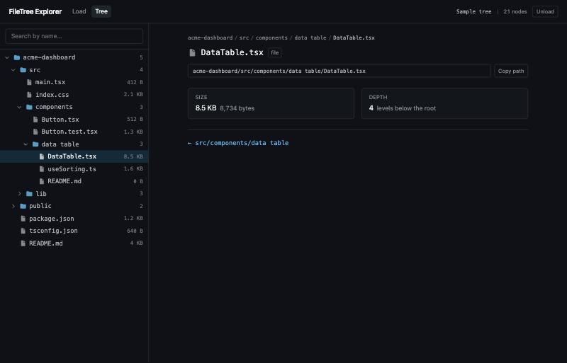

# FileTree Explorer

Paste or upload a JSON directory tree and navigate it: an expandable tree, details for
every file and folder, and search across the whole structure. Everything happens in the
browser — the document never leaves the tab.

**Live demo:** https://jaworskig00.github.io/filetree-explorer/



## Running it

```bash
npm install
npm run dev
```

Node.js 20.19 or newer. The brief asks for Node 18+, and 18 reached end of life in
April 2025; the current toolchain (Vite 8, Vitest 4, ESLint 10) no longer supports it.
Staying on 18 would have meant Vitest 3, which carries two open critical advisories, so
the floor was raised rather than the dependencies pinned backwards. CI runs the whole
check suite on 20.19, 22 and 24.

| Script           | What it does                                              |
| ---------------- | --------------------------------------------------------- |
| `npm run dev`    | Dev server                                                |
| `npm run build`  | Type-check and build                                      |
| `npm run test`   | Vitest in watch mode                                      |
| `npm run verify` | Everything CI runs: types, lint, formatting, tests, build |

## Routes

| Path           | View                                                                      |
| -------------- | ------------------------------------------------------------------------- |
| `/`            | Paste, drop or upload a JSON tree, or load the bundled sample             |
| `/tree`        | The tree, with the root folder's details                                  |
| `/tree/<path>` | The tree, with that node selected, e.g. `/tree/src/components/Button.tsx` |

## Architecture decisions

### The node route is a splat, not `:nodePath`

The brief writes the detail route as `/tree/:nodePath` with a value like
`src/components/Button.tsx`. A dynamic segment in React Router v6 does not match
slashes, so the route is `/tree/*` and the path is read from `params['*']`. That keeps
the URL readable and linkable:

```
/tree/src/components/Button.tsx
```

The alternative — one segment holding `src%2Fcomponents%2FButton.tsx` — produces opaque
URLs and depends on servers and proxies leaving `%2F` alone, which they often do not.

Each segment is encoded on its own when a link is built ([`nodePath.ts`](src/domain/nodePath.ts)),
so a name containing `#`, `?`, `%`, a space or a backslash stays inside its segment. The
router percent-decodes the splat before handing it over, so the path is reassembled by
splitting on `/` and nothing is decoded twice. Names containing a slash are rejected at
validation time, which is what makes that split unambiguous.

### What survives a reload, and where it lives

Two different kinds of state, two different homes:

- **The document** goes to `sessionStorage`, as the **raw JSON text only**. On boot it is
  parsed again and the index rebuilt. Derived data is never stored, because a stored index
  is the thing that goes stale the moment the shape of the index changes. Session storage,
  not local storage: the document belongs to the tab you are inspecting in.
- **The search query** goes to the **URL** as `?q=`. That makes results survive a reload,
  work with the back button, and be shareable — for free, with no storage involved.

Expanded folders are kept under a separate storage key, so opening a folder does not
rewrite a possibly multi-megabyte document on every click. Every storage access is
guarded: with storage blocked or full the app still works, and when a document is too
large to keep, the UI says plainly that a reload will lose it.

### One index instead of walking the tree per render

Two of the required views ask recursive questions: the total size of a subtree, and the
full path of every search hit. Answering them during render means re-walking the tree for
every row on screen.

Instead [`buildIndex.ts`](src/domain/buildIndex.ts) flattens the tree once per document:

- a depth-first pre-order pass with an explicit stack (so depth cannot overflow the call
  stack) produces every node with its path, parent, depth and children;
- a single pass **backwards** over that list accumulates subtree sizes and counts — in
  pre-order every node precedes its descendants, so walking back means children are always
  finished before their parent.

After that, node details are a map lookup, search is one linear scan over data that already
carries its path, and the visible rows of the tree are derived in a single pass that skips
everything under a collapsed folder.

### Validation that is useful, without a schema library

[`parseTree.ts`](src/domain/parseTree.ts) is hand-written rather than Zod, for two reasons
beyond dependency count. It collects **every** problem in one pass with the location it
happened (`root.children[1].size`), so a broken file is fixed in one round instead of one
error per attempt. And it **rebuilds** the tree from scratch instead of casting the parsed
JSON, so unknown keys and `__proto__`-style payloads cannot reach the rest of the app.

It also draws a line between what is wrong (a file with children, a negative size) and what
is merely odd (a size on a folder, a duplicate name, an unknown property): the first blocks
loading, the second is reported and the document still opens.

### The tree renders flat

Rows are rendered as one flat list rather than nested lists, because visibility is derived
in a single pass over the pre-ordered index. ARIA levels carry the structure the DOM no
longer shows, which is the same approach a virtualised tree has to take, so adding
virtualisation later does not mean rewriting the component.

The tree is operable from the keyboard — arrows move, right and left open and close, Home
and End jump, Enter follows the row — with one row in the tab order at a time, so tabbing
past the tree does not mean tabbing through every file in it.

### No second copy of the search query

The search input renders the URL value directly and writes back to it. There is no local
draft to keep in sync, so there is no effect synchronising state with the URL, and the back
button needs no special handling. Typing stays responsive through `useDeferredValue` around
the result list rather than a debounce timer: the input updates immediately, the expensive
list catches up.

### The domain layer has no React in it

`src/domain` is plain TypeScript: types, validation, index, paths, formatting, search. That
is where the logic worth testing lives, and it is tested without rendering anything. React
only arranges it on screen.

### Smaller decisions

- **TypeScript**: `strict`, plus `noUncheckedIndexedAccess` and `exactOptionalPropertyTypes`,
  which is what makes an optional `size` and an out-of-range array index visible problems
  rather than runtime surprises.
- **Tailwind v4** through its Vite plugin: no `tailwind.config.js`, no PostCSS setup, and a
  handful of semantic colour tokens in `index.css` so a colour is decided once.
- **Dark theme only.** This is a tool that sits next to an editor; one theme means one set
  of contrast decisions, properly made.
- **Exact dependency versions**, so a reviewer installs what was tested.

## Tests

```bash
npm run test
```

77 tests, in two layers:

- **Domain** — validation (including the limits and the `__proto__` case), index building
  and subtree totals verified against hand-computed numbers, path encoding round-trips,
  size formatting, search behaviour.
- **Application** — the real router and the real session storage: pasting a document,
  deep-linking into a node, a reload restoring both the document and the search results, a
  path containing a space, a link to a node that no longer exists, and keyboard navigation.

## Known limitations

- **No virtualisation.** Rows are only rendered for folders that are open, so the default
  view is cheap, but expanding a folder with tens of thousands of children renders every
  one of them.
- **Session storage caps the document at roughly 5 MB.** Larger documents load and work;
  they just do not survive a reload, and the UI says so instead of failing quietly.
- **Hard limits**: 200,000 nodes and 200 levels of depth, and uploads are capped at 25 MB.
  Past those the document is rejected with a message rather than freezing the tab.
- **Duplicate names in one folder**: the first one wins, since two children with the same
  name map to the same path. The duplicate is reported as a warning and is not reachable.
- **Names containing a slash are rejected** — they would make a path ambiguous.
- **Search matches a substring of the name only.** No fuzzy matching, no ranking, no
  searching inside paths.
- **React Router v6 carries two open moderate advisories** (an open redirect through a
  backslash in `Link`/`useNavigate`, and an SSR hydration issue). v6 is a requirement of
  the brief and the fix only exists in v7. The SSR one does not apply — this is a
  client-only app — and every path segment is passed through `encodeURIComponent` before it
  reaches a link, so a name containing a backslash cannot turn into an external redirect.
- No light theme, no i18n, and no persistence beyond the current tab.

## With more time

- **Virtualise the tree** so a fully expanded 200,000-node document stays smooth, and move
  parsing and indexing into a Web Worker so the UI never blocks on a large file.
- **Better search**: fuzzy matching with ranking, matching inside paths as well as names,
  and filters by type and size.
- **Views that answer questions the brief does not ask yet** — largest files, deepest
  paths, a treemap of where the bytes are, and a diff between two trees.
- **End-to-end tests in Playwright** for the parts jsdom cannot really prove: drag and drop,
  the clipboard, a genuine browser reload, and the Pages deployment with its 404 fallback.
- **Lift the storage ceiling** with IndexedDB, which would also make several documents open
  at once possible.

## Project layout

```
src/
  domain/      types, validation, index, paths, size formatting, search  (no React)
  state/       document provider and session persistence
  components/  tree, search, breadcrumbs, shell
  pages/       home, tree layout, node details, 404
  router.tsx   the three routes from the brief
```
